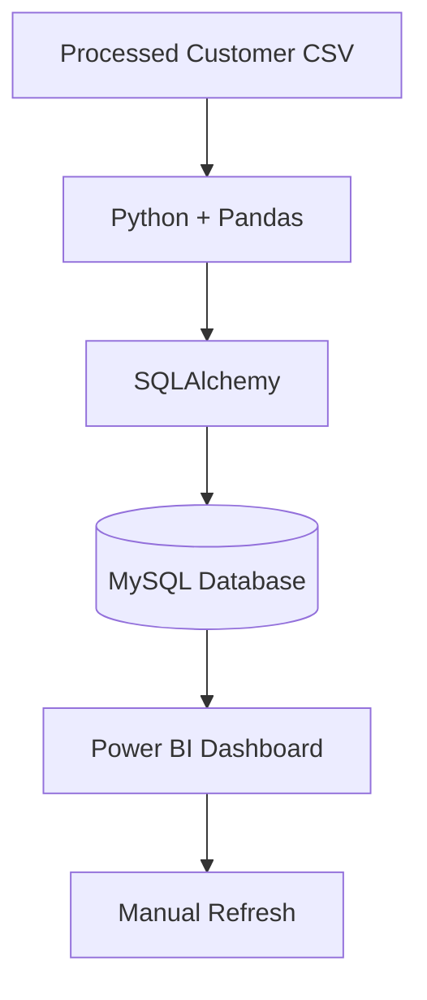

# Customer Churn & Retention Analysis

A data analytics project focused on understanding customer churn, identifying high-risk customer segments, and exploring strategies to improve customer retention.

## Project Overview

This project analyzes customer churn data to identify patterns behind customer cancellations and understand which customer segments are more likely to churn.

Using Python, SQL, MySQL, and Power BI, the project explores customer behavior, analyzes churn patterns, identifies high-risk segments, and presents insights through an interactive dashboard.

## Business Objectives

- Identify key factors associated with customer churn.
- Analyze churn across different customer segments.
- Identify high-risk customer groups.
- Understand the relationship between tenure, contract type, and monthly charges with churn.
- Provide data-driven insights to support customer retention strategies.

## Tools & Technologies

- **Python** – Data analysis and data processing
- **Pandas** – Data manipulation and analysis
- **Matplotlib** – Data visualization
- **MySQL** – Database management and SQL analysis
- **SQLAlchemy** – Python-to-MySQL database integration
- **MySQL Connector** – Database driver
- **Power BI** – Interactive dashboard development
- **Git & GitHub** – Version control

## Project Workflow

1. Dataset Understanding
2. Exploratory Data Analysis (EDA)
3. Data Cleaning & Preparation
4. Customer Churn Analysis using SQL
5. Data Visualization using Matplotlib
6. Data Validation
7. MySQL Database Integration
8. Interactive Power BI Dashboard Development
9. Pipeline Testing

## Key Business Insights

- Overall customer churn rate was approximately **26.54%**.
- Month-to-month customers had the highest churn rate of **42.71%**.
- Customers with two-year contracts had a significantly lower churn rate of **2.83%**.
- Customers with shorter tenure were more likely to churn.
- Higher monthly charges were associated with higher churn.
- Customers with month-to-month contracts and high monthly charges formed a high-risk segment, with a churn rate of **52.33%**.

## Data Validation

A Python-based validation script was developed to check the quality and consistency of the customer dataset.

### Validation Features

- **48 automated validation checks**
- Required column validation
- Data type validation
- Missing value checks
- Duplicate record detection
- Categorical value validation
- Blank string validation
- Numerical range validation
- Customer ID validation
- Validation logging and final report

The validation process was tested using valid and invalid datasets to evaluate data quality.

## SQL Analysis

MySQL was used to investigate customer churn patterns and answer business questions.

### Analysis Performed

- Customer counts and distributions
- Overall churn rate calculation
- Churn rates across customer segments
- Contract-based churn analysis
- Tenure-based customer analysis
- Monthly charges and churn relationships
- Customer segmentation using SQL
- Common Table Expressions (CTEs)
- Conditional analysis using CASE WHEN
- Grouping and aggregations

## Data Pipeline & Database Integration

A Python-based data pipeline was developed and tested to connect the processed customer dataset with MySQL using SQLAlchemy.

### Pipeline Architecture



### Pipeline Workflow

1. Read the cleaned customer dataset using Pandas.
2. Load database credentials from the `.env` file.
3. Establish a MySQL connection using SQLAlchemy and MySQL Connector.
4. Create the customer table in MySQL.
5. Load customer records into the database.
6. Verify the number of records loaded.
7. Connect Power BI to the MySQL database.
8. Refresh Power BI manually to reflect database changes.

### Pipeline Testing

The integration was tested using a separate MySQL database named `churn_test_db`.

Testing included:

- SQLAlchemy database connection verification.
- Customer table creation.
- Loading **7,043 customer records** from the processed CSV.
- Database record count verification.
- Inserting a temporary test customer through Python.
- Verifying the inserted record in MySQL.
- Confirming the record appeared in Power BI after refreshing.
- Removing the temporary test record after testing.

**Note:** Data loading is script-driven rather than scheduled. Power BI requires a manual refresh to reflect database changes.

## Power BI Dashboard

The Power BI dashboard provides an interactive overview of customer churn and enables exploration of customer segments using different metrics and filters.

The dashboard is connected to MySQL as its data source.

### Dashboard Preview


## Project Structure

```text
Customer-Churn-Analysis/
│
├── dashboard/
│   └── Customer_Churn_Dashboard - sql.pbix
│
├── data/
│   ├── raw/
│   ├── processed/          # Kept locally
│   └── incoming/           # Kept locally
│
├── images/
│   └── customer_churn_analysis_dashboard_screenshot.png
│
├── notebooks/
│   └── customer_churn_analysis.ipynb
│
├── scripts/
│   ├── validate_data.py
│   ├── generate_test_data.py
│   ├── test_sqlalchemy_connection.py
│   ├── create_test_table.py
│   ├── load_test_data.py
│   └── test_live_pipeline.py
│
├── sql/
│   ├── customer_churn_analysis.sql
│   └── verification_queries.sql
│
├── .gitignore
├── requirements.txt
└── README.md
```

*Processed datasets, incoming test data, environment credentials, and personal notes are kept locally and excluded from Git version control.*

## Dataset

**IBM Telco Customer Churn Dataset**

The dataset contains customer information, service subscriptions, account details, and churn status.

- **Total Records:** 7,043 customers
- **Total Columns:** 21
- **Target Variable:** `Churn`

## Requirements

- Python 3.x
- MySQL Server
- Power BI Desktop
- Git

### Python Dependencies

- pandas
- matplotlib
- mysql-connector-python
- SQLAlchemy
- python-dotenv
- jupyter

## Installation & Setup

### 1. Clone the Repository

```bash
git clone <repository-url>
cd Customer-Churn-Analysis
```

### 2. Install Dependencies

```bash
pip install -r requirements.txt
```

### 3. Configure Database Credentials

- Install and start MySQL Server.
- Create a MySQL database named `churn_test_db`.
- Create a `.env` file in the project root.
- Add your database credentials:

```env
DB_USER=your_mysql_username
DB_PASSWORD=your_mysql_password
DB_HOST=localhost
DB_PORT=3306
```

Database credentials are loaded through environment variables and excluded from version control using `.gitignore`.

### 4. Test the Database Connection

```bash
python scripts/test_sqlalchemy_connection.py
```

### 5. Create the Customer Table

```bash
python scripts/create_test_table.py
```

### 6. Load Customer Data

Make sure the cleaned dataset is available locally at:

`data/processed/Telco-Customer-Churn-Clean.csv`

Run:

```bash
python scripts/load_test_data.py
```

The loading script checks whether the destination table already contains records before loading. It stops if the table is not empty to prevent accidental duplicate imports.

### 7. Explore the Project

- Explore the notebook in `notebooks/`.
- Review SQL queries in `sql/`.
- Explore Python scripts in `scripts/`.
- Open the Power BI dashboard in `dashboard/`.

## Conclusion

This project demonstrates practical data analytics skills through customer churn analysis, data cleaning, SQL querying, data visualization, dashboard development, data validation, and Python-to-MySQL integration.

The analysis identifies customer segments associated with higher churn and provides insights that can support data-driven customer retention strategies.