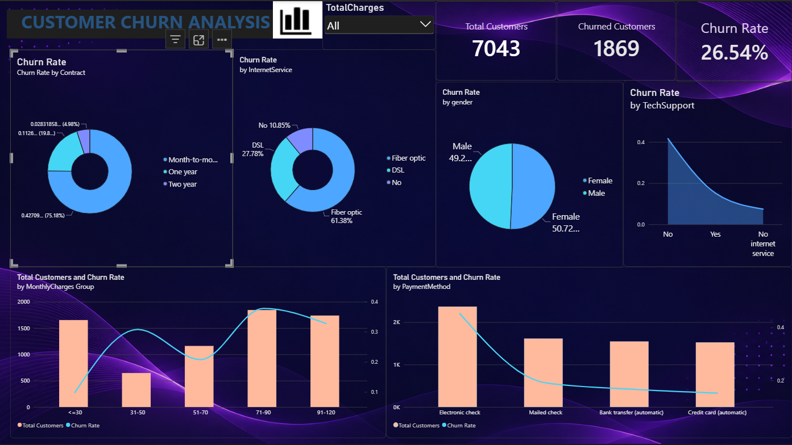

# Customer Churn & Retention Analysis

A data analytics project focused on understanding customer churn, identifying high-risk customer segments, and exploring strategies to improve customer retention.

## Project Overview

This project analyzes customer churn data to identify patterns behind customer cancellations and understand which customer segments are more likely to churn.

The project follows an end-to-end data analytics workflow using Python, MySQL, and Power BI, covering data exploration, cleaning, SQL analysis, visualization, dashboard development, and data pipeline automation.

## Business Objectives

- Identify key factors contributing to customer churn.
- Analyze churn across different customer segments.
- Identify high-risk customer groups.
- Understand the relationship between tenure, contract type, and monthly charges with churn.
- Provide data-driven insights to support customer retention strategies.

## Tools & Technologies

- **Python** – Data analysis and automation
- **Pandas** – Data manipulation and analysis
- **Matplotlib** – Data visualization
- **MySQL** – Database storage and SQL analysis
- **Power BI** – Interactive dashboard development
- **Git & GitHub** – Version control and project management

## Project Workflow

1. Dataset Understanding
2. Data Exploration using Python & Pandas
3. Data Cleaning
4. SQL Analysis using MySQL
5. Customer Analysis & Visualization using Matplotlib
6. Interactive Power BI Dashboard connected to MySQL
7. Data Pipeline Automation & Validation

## Key Insights

- Overall customer churn rate was approximately **26.54%**.
- Month-to-month customers had the highest churn rate of **42.71%**.
- Customers with two-year contracts had a significantly lower churn rate of **2.83%**.
- Customers with shorter tenure were more likely to churn.
- Higher monthly charges were associated with higher churn.
- Customers with month-to-month contracts and high monthly charges formed a high-risk segment, with a churn rate of **52.33%**.

## Data Pipeline Automation

The project includes an automated data pipeline built using Python to validate data and load it into MySQL.

### Key Features

- **48 automated validation checks**
- Validation of data types, missing values, duplicate records, categorical values, and numerical ranges
- Automated data loading into MySQL
- Handling of new records
- Updating existing records without creating duplicates
- Prevention of invalid data from entering the database
- Logging of validation results and pipeline activity

The pipeline was tested using valid and invalid datasets to verify data validation, insertion, updating, and rejection behavior.

## Dashboard & Database Integration

The Power BI dashboard is connected directly to **MySQL**, using the database as its data source instead of CSV files.

The project demonstrates integration between Python, MySQL, and Power BI in an end-to-end data analytics workflow.

## Dashboard Preview

The interactive Power BI dashboard allows users to explore customer churn patterns and analyze customer segments using different metrics and filters.



## Project Structure

```text
Customer-churn-analysis/
├── automation/
├── dashboard/
├── data/
├── images/
├── notebooks/
├── reports/
├── sql/
└── README.md
```

## Data Source

The project uses the **IBM Telco Customer Churn dataset**, containing customer information, services, account details, and churn status.

- **Total records:** 7,043 customers
- **Total columns:** 21
- **Target variable:** `Churn`

## Requirements

- Python 3.x
- MySQL Server
- Power BI Desktop
- Git

## Installation & Setup

### 1. Clone the Repository

```bash
git clone <repository-url>
cd Customer-churn-analysis
```

### 2. Install Python Dependencies

```bash
pip install -r requirements.txt
```

### 3. Configure MySQL

- Install and start MySQL Server.
- Create the project database.
- Configure your MySQL credentials in the database connection file.

### 4. Run the Project

- Explore the notebooks in the `notebooks/` folder.
- Execute SQL queries from the `sql/` folder.
- Run the automation scripts from the `automation/` folder.
- Open the Power BI dashboard from the `dashboard/` folder.

## Conclusion

This project demonstrates an end-to-end data analytics workflow, from data exploration and cleaning to SQL analysis, visualization, dashboard development, and data pipeline automation.

The analysis identified key customer segments associated with higher churn and provided data-driven insights that can support customer retention strategies.

